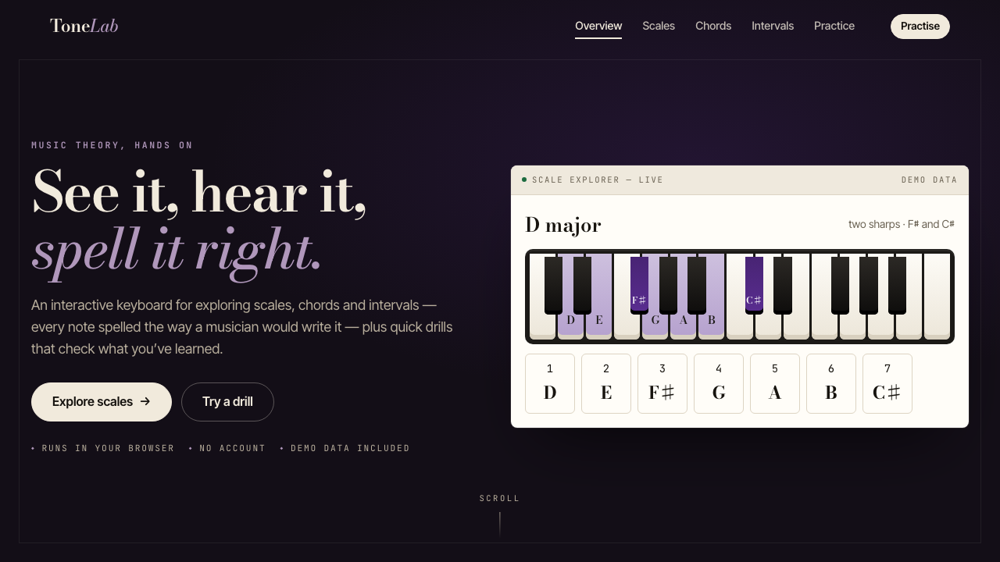
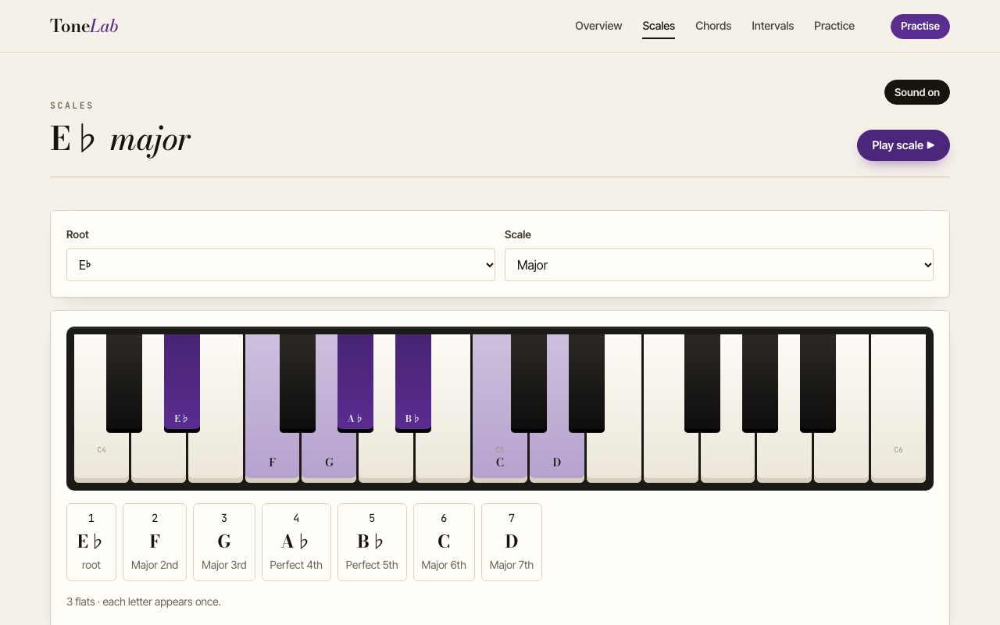
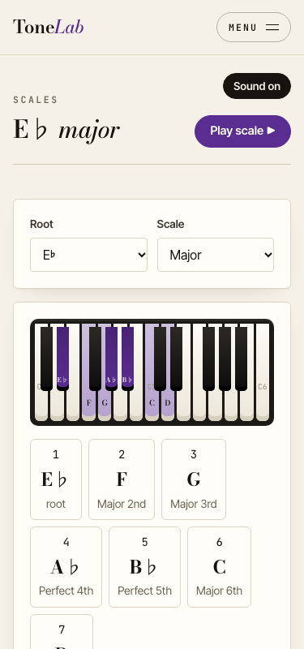

# Tone Lab

Hands-on music theory: a playable two-octave keyboard (mouse, touch or computer keys) with Web Audio sound, scale and chord explorers that spell every note correctly for its key, an interval finder, and quick drills with a score.

**Live demo:** [https://tone-lab-app.vercel.app/](https://tone-lab-app.vercel.app/) — runs entirely in your browser.



| Scale explorer | Mobile |
| --- | --- |
|  |  |

## Run it

```bash
npm install
npm run dev        # http://localhost:5220
npm test
npm run build
npm run test:e2e   # Playwright smoke test (npm run e2e:install once if Chromium is missing)
```

## Main workflow

1. **Scales** → choose one of twelve roots and seven scales (major, natural and harmonic minor, Dorian, Mixolydian, major and minor pentatonic). Notes light up on the keyboard with their spelled names, degrees and intervals from the root; **Play scale** plays it up an octave.
2. **Chords** → nine qualities (major, minor, diminished, augmented, sus2, sus4, 7, maj7, m7) with a table of chord tones and intervals; play as a block chord or arpeggio.
3. **Intervals** → click two keys to name the interval, see the semitones and frequency ratio, and hear it.
4. **Practice** → name the interval, name the chord (multiple choice), or build a scale by selecting keys. Current run, best run and accuracy by drill type are saved.
5. With any keyboard focused, **A W S E D F T G Y H U J K** play C4 to C5. **Sound on/off** is remembered.

## Rules

- Spelling uses letter steps, so each scale uses every letter once: F major has B♭ (not A♯), F♯ major has E♯, A harmonic minor raises G to G♯.
- Intervals are named from both letter distance and semitones (C–D♯ is an augmented 2nd, C–E♭ a minor 3rd); on the keyboard page, keys have no spelling, so the common name is used and the tritone note explains both spellings.
- Sound is a small synthesised voice (triangle wave plus a quiet octave) with a short attack and decay.

## Design

Shared editorial system: Bodoni Moda display type for note names, Inter Tight interface text, a dark keyboard with accent-lit keys and labels on the keys themselves, an ink hero with a live scale, and a warm paper workspace. Key-press animation is removed under `prefers-reduced-motion`.

## Tests

- `src/lib/theory.test.ts` — note parsing and naming, spelling above a root, major/minor/modal/pentatonic scales in sharp and flat keys, chord spelling, interval names by letter distance, frequencies, keyboard mapping, pitch-set comparison.
- `src/App.test.tsx` — scale spelling as root and scale change, chord tones, interval by clicks and computer keys, a drill answer and next question, building a scale.
- `e2e/smoke.spec.ts` — landing, scales, chords, intervals and a drill with reload persistence, plus 375px layout checks.

## Limitations

- No ear-training by sound alone yet — drills show the notes as well as playing them.
- Two octaves only; no MIDI input.
- Sound needs Web Audio and a user gesture to start (browser autoplay rules).

## Future improvements

- Ear-training mode (hear, then answer), MIDI keyboard input, and staff notation.

## Licence

MIT — see [LICENSE](LICENSE).
